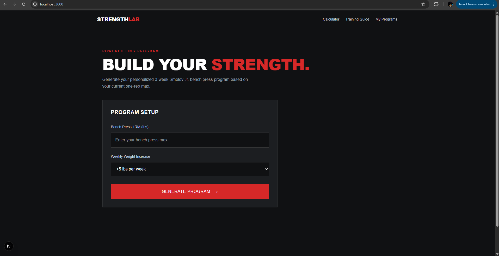
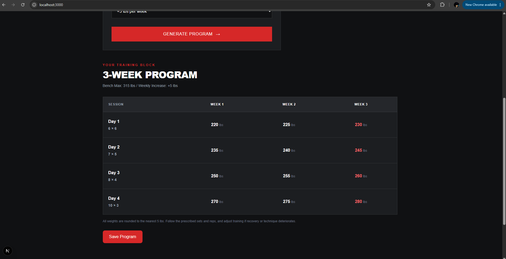
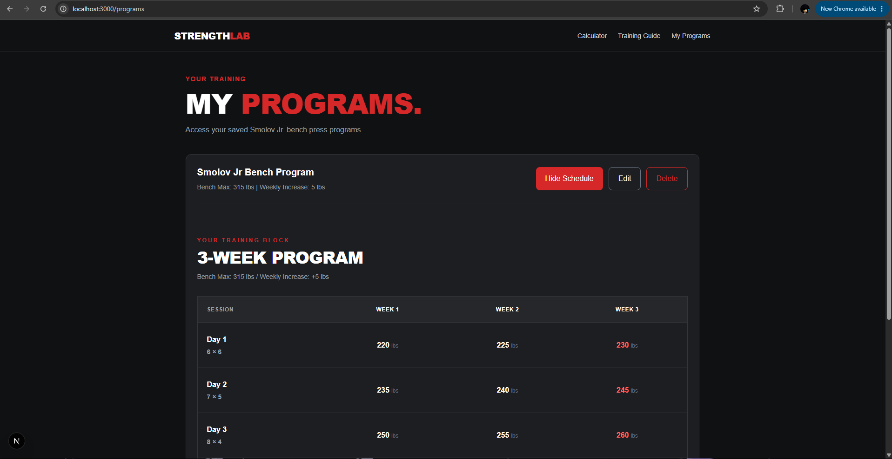

# StrengthLab

**A full-stack strength training application built with Next.js, ASP.NET Core Web API, Entity Framework Core, and SQL Server.**

StrengthLab helps lifters generate, save, and manage personalized Smolov Jr. bench press training programs based on their one-rep max (1RM).

The application features a responsive frontend, a C# REST API, and persistent SQL Server storage with full CRUD functionality.

## Features

- **Smolov Jr. Program Generator:** Generate a 3-week bench press training schedule based on your 1RM.
- **Customizable Progression:** Choose between 5 lb and 10 lb weekly weight increases.
- **Workout Schedule:** View calculated weights, sets, and reps for all four weekly training sessions.
- **Save Programs:** Store generated training programs in SQL Server.
- **My Programs Dashboard:** Retrieve and view previously saved programs.
- **Edit Programs:** Update your bench max and weekly increment.
- **Delete Programs:** Remove programs you no longer need.
- **Training Guide:** Access guidance on warm-ups, recovery, accessory training, and program execution.
- **Responsive Interface:** Dark-themed, mobile-friendly design.

## Tech Stack

| Layer | Technologies |
|---|---|
| Frontend | Next.js, React, JavaScript, Tailwind CSS |
| Backend | C#, ASP.NET Core Web API |
| Database | Microsoft SQL Server |
| ORM | Entity Framework Core |
| API Documentation | OpenAPI, Swagger UI |
| Development Tools | Visual Studio, VS Code, SSMS, Git, GitHub |

## Architecture

```text
Next.js Frontend
       |
       | HTTP Requests (GET, POST, PUT, DELETE)
       v
ASP.NET Core Web API
       |
       v
Entity Framework Core (DbContext)
       |
       v
SQL Server Database
```

## API Endpoints

| Method | Endpoint | Description |
|---|---|---|
| GET | `/api/programs` | Retrieve all saved programs |
| GET | `/api/programs/{id}` | Retrieve a program by ID |
| POST | `/api/programs` | Create a new program |
| PUT | `/api/programs/{id}` | Update an existing program |
| DELETE | `/api/programs/{id}` | Delete a program |

The API uses asynchronous database operations and returns HTTP status codes including `200 OK`, `201 Created`, `204 No Content`, and `404 Not Found`.

## Getting Started

### Prerequisites

- Node.js and npm
- .NET 10 SDK
- SQL Server LocalDB or another SQL Server instance
- SQL Server Management Studio (SSMS)
- Visual Studio or a compatible C# development environment

### 1. Clone the repository

```bash
git clone https://github.com/basiliqbal/strengthlab.git
cd strengthlab
```

### 2. Configure the backend

Open `StrengthLab.slnx` in Visual Studio.

Verify the SQL Server connection string in `StrengthLab.API/appsettings.json`:

```json
"ConnectionStrings": {
  "DefaultConnection": "Server=(localdb)\\MSSQLLocalDB;Database=StrengthLabDB;Trusted_Connection=True;TrustServerCertificate=True;"
}
```

Update the connection string if you're using a different SQL Server instance.

From the backend project directory, apply the Entity Framework Core migrations using Visual Studio's Package Manager Console:

```powershell
Update-Database
```

Start the ASP.NET Core API using Visual Studio.

The configured development launch profile uses:

```text
https://localhost:7231
```

Swagger UI is available in Development at:

```text
https://localhost:7231/swagger
```

### 3. Configure the frontend

From the repository root, install dependencies:

```bash
npm install
```

Create a `.env.local` file in the root directory:

```env
NEXT_PUBLIC_API_URL=https://localhost:7231
```

Start the Next.js development server:

```bash
npm run dev
```

Open:

```text
http://localhost:3000
```

Make sure the backend is running before attempting to save or retrieve programs.

## Database Structure

The application uses Entity Framework Core migrations to manage the database schema.

The `TrainingPrograms` table contains:

| Column | Description |
|---|---|
| Id | Primary key |
| Name | Training program name |
| BenchMax | Bench press one-rep max |
| WeeklyIncrement | Weekly weight increase |
| CreatedAt | Program creation timestamp |

## How It Works

1. Enter a bench press one-rep max.
2. Select a weekly progression increment.
3. Generate a personalized 3-week Smolov Jr. schedule.
4. Save the program through the ASP.NET Core API.
5. Access saved programs from the My Programs page.
6. View, edit, or delete programs as needed.

Program weights are calculated using the selected 1RM, prescribed training percentages, and weekly increments.

## Screenshots

### Program Calculator


### Workout Schedule


### My Programs


## Project Status

The core full-stack application is functional, including program generation, SQL Server persistence, and frontend CRUD operations.

**Note:** This version does not include user authentication. Saved programs belong to the shared application database rather than individual user accounts.

## Author

**Basil Iqbal**

[GitHub](https://github.com/basiliqbal)